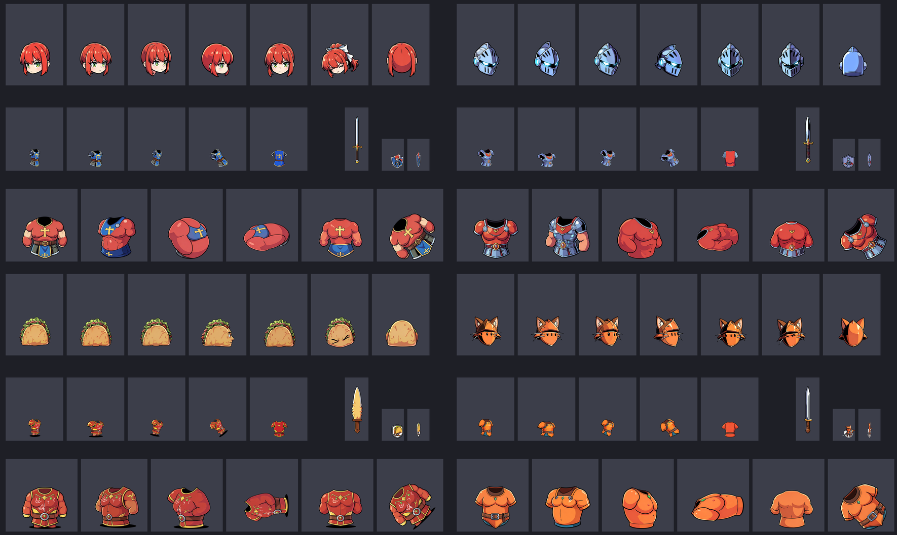
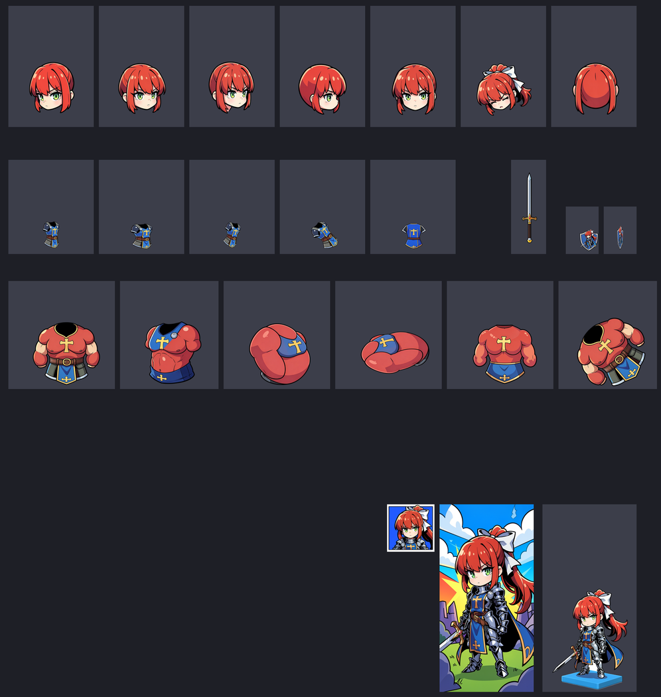

# PBP Studio

[](https://github.com/SenjuWoo/pbp-studio/actions/workflows/ci.yml)

Turn a text idea into a **Castle Crashers custom character** for the *Painter Boss Paradise* DLC -
local, no account, no upload.



*Four characters generated from one sentence each (heads, bodies, weapon, shields and giants shown; the
template's own artwork is not part of these images).*

You type something like *"red-haired knight girl with a white ribbon, silver armor, blue tabard"*, pick a
name and a magic, press **Generate character**, and the app:

1. draws **one full-body master design** with a local anime model (or uses your own image),
2. redraws every template piece from that master with an image-edit model, so hair, colours and trim are
   the same in all **7 head angles, 5 bodies, 6 giant torsos, weapon, shields, portrait icon, select banner
   and figurine**,
3. cuts each piece out of its white background, rejects blank / multi-figure / wrong-colour results and
   retries, and places it in its box at the size and position real Workshop characters use,
4. writes `painting.png` + `pbp.xml` into a folder the in-game painter can load and hot-reload.

The poses follow the template: head slots 1-3 face almost the viewer with a growing turn to the right, 4 is a
right profile, 5 straight on, 6 a forward tilt, 7 the back; the 4th giant lies on its back. The 15
beefy-form **limb boxes keep the template's own dark art** (what most Workshop characters do).

> **Status: beta.** Validated offline (tests), on four very different test characters, and against the layout
> of 37 real Workshop atlases. It has not been checked in game by the author yet, so the first in-game load
> is the real test - please report what you see.

## Requirements

- Windows 10/11, Python 3.10+ (the launcher creates a local `.venv`, nothing system-wide).
- Castle Crashers with the *Painter Boss Paradise* DLC, to load and publish the character.
- [SwarmUI](https://github.com/mcmonkeyprojects/SwarmUI) (auto-detected, auto-started on port 7801) with:
  - an Anima model for the design step (developed with `woomixAnima_v15`), and
  - **Flux.2 Klein 4B fp8** for the pieces: download
    [`flux-2-klein-4b-fp8.safetensors`](https://huggingface.co/black-forest-labs/FLUX.2-klein-4b-fp8)
    (4.1 GB) into `SwarmUI/Models/diffusion_models`. SwarmUI fetches its text encoder itself.
  - optional: [Qwen Image 2.1 turbo int8](https://huggingface.co/Comfy-Org/Qwen-Image-2.1)
    (`qwen_image_2.1_turbo_int8_convrot.safetensors`, 7.3 GB, same folder).
- A GPU that runs Flux.2 Klein 4B fp8 (about 8 GB VRAM per its docs; developed and measured on 16 GB).

### Which model

Same design and seed, one full character, RTX 4080 SUPER 16 GB:

| Model | Time | Gate retries | Result |
|---|---|---|---|
| **Flux.2 Klein 4B fp8** (default) | about 4-5 min | 0-14 | one identity everywhere, torso pieces keep the clothing |
| Qwen Image 2.1 turbo int8 | 20 min 40 s | 18 | heads match, torso pieces come out as thin tabard strips |
| Anima only | 10 min 45 s | 0 | off-model: knight busts as heads, full figures in body boxes |

*Anima only* needs no download but cannot keep one identity across the pieces (each box is a separate
drawing); treat it as a fallback. Every default (sampler, CFG, steps, prompt format, Klein steps, head angles)
comes from a measured sweep: see [docs/TUNING.md](docs/TUNING.md).

## Run

Double-click `START.bat` (first run installs Pillow/numpy/scipy into `.venv`). The UI opens at
<http://127.0.0.1:8777/>.

1. **Describe your character** - say what it looks like (head, outfit, colours). Optionally upload your own
   character image instead, or tick *Reuse the last design* to rebuild all pieces from the previous master
   (handy when the design is right and a piece is not).
2. **Name & magic** - 26 in-game magics.
3. **Output folder** - pick the folder the game watches, press *Generate character* (about 4-5 minutes on
   Klein; the first run also loads the models).
4. In game: **Painter Boss Paradise -> Browse Folder** -> pick that folder. The preview updates live. Test
   the character and publish to the Workshop from the in-game menu.

`Install into game (pbplocal)` copies the finished folder into `CastleCrashers\data\pbplocal\<name>\`.

Command line, no browser (repeatable runs, comparisons):

```bash
py -3 tools/bench.py klein --design "your text" [--master design.png] [--seed 5] [--out DIR]
py -3 tools/tune.py master sampler      # the settings sweeps behind docs/TUNING.md
```

### Output

The whole painted atlas for one character (the template's artwork around the boxes is omitted here):



## How it works

- `app/regions.py` - the 39 draw boxes of the official 2048x2048 template: its 39 transparent connected
  components, exact to the pixel (the game slices these).
- `app/layout_stats.json` - median art size and position per box over 37 real Workshop atlases (numbers only,
  no art). Heads sit at x 24-78 %, y 47-89 % of their box in every character; bodies are small torso
  garments; the weapon is one vertical item.
- `app/pipeline.py` - master design, per-piece edit prompts, front-head and torso reference bridges, measured
  head turns, rotate/squash for landing / run / spin / the lying giant / shield edge, cut-out, quality gates,
  fitting, compositing.
- `app/engine.py` - template discovery, SwarmUI client (restarts an errored backend, times out and interrupts a
  stalled render), job runner, `painting.png` + `pbp.xml` writer.
- `app/magics.py` - the `<magictype>` table (indexes verified against the shipped template and the game exe).
- `app/server.py` - local HTTP/JSON server (binds 127.0.0.1 only).
- `docs/HOW-IT-WAS-MADE.txt` - the format research and design notes; `docs/TUNING.md` - the measured sweeps.
- `tests/` - offline tests (fake SwarmUI on a synthetic template): `python -m pytest`.

The template is never redistributed: the app uses your installed game's copy, or downloads the official one
from `castlecrashers.com`, and caches it in `%LOCALAPPDATA%\PBP-Studio`.

## Notes

- Everything runs locally. The only network use is the optional one-time template download when no game
  install is found.
- The `pbp.xml` written by the app is the format the game itself uses
  (`<character displayname="..."><magictype>N</magictype></character>`).
- Workshop publishing and validation stay in game (the game owns the upload and the container format).
- Job logs are in the UI; rejected generations and the master design are kept in
  `%LOCALAPPDATA%\PBP-Studio\jobs\<id>\`.
- Castle Crashers and Painter Boss Paradise are (c) The Behemoth. This is an unofficial fan tool.
