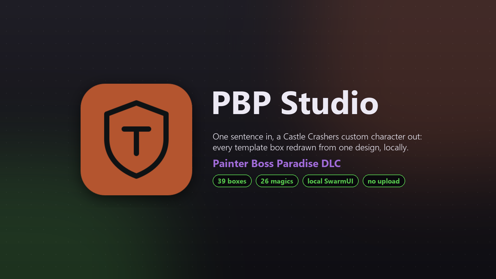
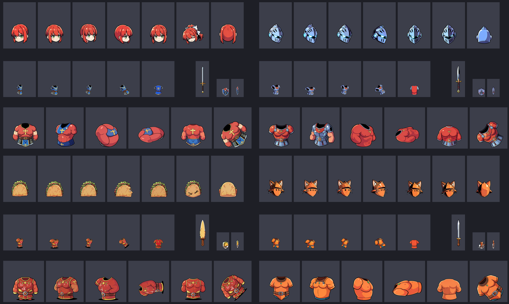
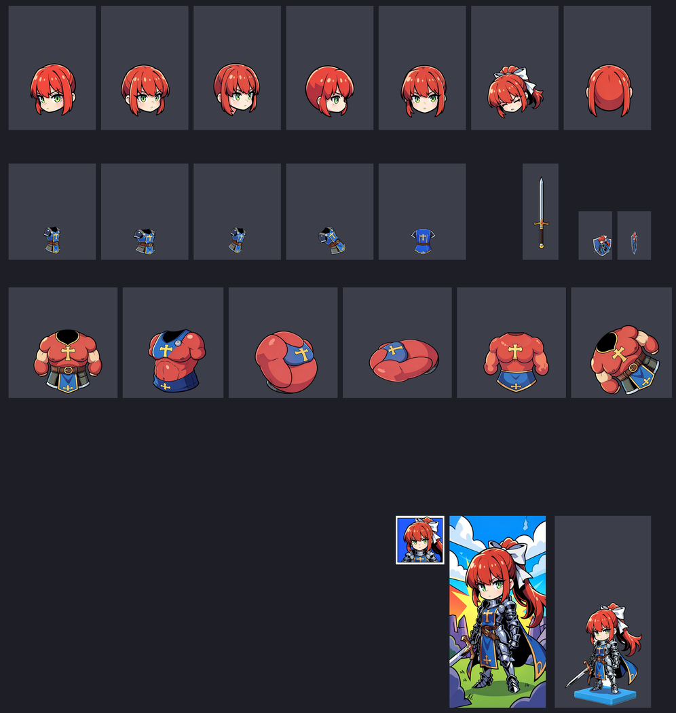

**[Install](#install)** · **[Run](#run)** · **[Which model](#which-model)** · **[Commands](#commands)** · **[How it works](#how-it-works)** · **[Changelog](CHANGELOG.md)**

PBP Studio turns a text idea into a **Castle Crashers custom character** for the *Painter Boss Paradise* DLC.
You describe the character once. The app draws one master design, then redraws every box of the official
template from it, so the hair, colours and trim match in all 7 head angles, 5 bodies, 6 giant torsos, the
weapon, shields, portrait icon, select banner and figurine. It runs on your own machine with a local
SwarmUI: no account, no upload.

> **Status: beta.** Validated offline (tests), on four very different test characters, and against the layout
> of 37 real Workshop atlases. It has not been checked in game by the author yet, so the first in-game load
> is the real test - please report what you see.

## What you get

- **One identity across 39 boxes.** A full-body master design comes first (from your text, or your own image),
  and every piece is an edit of it, not a separate drawing.
- **Poses that follow the template.** Head slots 1-3 face almost the viewer with a growing, measured turn to the
  right, 4 is a right profile, 5 straight on, 6 a forward tilt, 7 the back; the 4th giant lies on its back. The
  15 beefy-form **limb boxes keep the template's own dark art** (what most Workshop characters do).
- **Pieces that fit.** Each piece is cut out of its white background, rejected and retried when it comes back
  blank, multi-figure or the wrong colour, and placed at the size and position real Workshop characters use.
- **Ready for the in-game painter.** It writes `painting.png` + `pbp.xml` into a folder the game loads and
  hot-reloads, and can copy the result into the game's own `data/pbplocal`.
- **Settings from measurement.** Sampler, CFG, steps, prompt format, Klein steps and head angles all come from
  reproducible sweeps ([docs/TUNING.md](docs/TUNING.md)).
- **Local only.** The server binds to `127.0.0.1` and answers only its own page; the only network use is the
  optional one-time template download.

*Four characters generated from one sentence each (heads, bodies, weapon, shields and giants shown; the
template's own artwork is not part of these images).*

*The real app page, captured headlessly from a running server (fresh profile, so the fields show their defaults).*

## Install

**Requirements**

- Windows 10/11 and Python 3.11+ (the launcher creates a local `.venv`; nothing is installed system-wide).
- Castle Crashers with the *Painter Boss Paradise* DLC, to load and publish the character.
- [SwarmUI](https://github.com/mcmonkeyprojects/SwarmUI) (auto-detected, auto-started on port 7801) with:
  - an Anima model for the design step (developed with `woomixAnima_v15`), and
  - **Flux.2 Klein 4B fp8** for the pieces: download
    [`flux-2-klein-4b-fp8.safetensors`](https://huggingface.co/black-forest-labs/FLUX.2-klein-4b-fp8)
    (4.1 GB) into `SwarmUI/Models/diffusion_models`. SwarmUI fetches its text encoder itself.
  - optional: [Qwen Image 2.1 turbo int8](https://huggingface.co/Comfy-Org/Qwen-Image-2.1)
    (`qwen_image_2.1_turbo_int8_convrot.safetensors`, 7.3 GB, same folder).
- A GPU that runs Flux.2 Klein 4B fp8 (about 8 GB VRAM per its docs; developed and measured on 16 GB).

**Steps**

1. Download `PBP-Studio-<version>.zip` from the [latest release](https://github.com/SenjuWoo/pbp-studio/releases/latest)
   and extract it anywhere (or `git clone https://github.com/SenjuWoo/pbp-studio`).
2. Double-click `START.bat`. The first run installs Pillow, numpy and scipy into `.venv`.
3. The UI opens at <http://127.0.0.1:8777/>. Set `PBP_PORT` to use another port.

## Run

1. **Describe your character** - say what it looks like (head, outfit, colours). Optionally upload your own
   character image instead, or tick *Reuse the last design* to rebuild all pieces from the previous master
   (handy when the design is right and a piece is not).
2. **Name & magic** - 26 in-game magics.
3. **Output folder** - pick the folder the game watches, press *Generate character* (about 4-5 minutes on
   Klein; the first run also loads the models).
4. In game: **Painter Boss Paradise -> Browse Folder** -> pick that folder. The preview updates live. Test
   the character and publish to the Workshop from the in-game menu.

`Install into game (pbplocal)` copies the finished folder into `CastleCrashers\data\pbplocal\<name>\`.

### Output

The whole painted atlas for one character (the template's artwork around the boxes is omitted here):

## Which model

Same design and seed, one full character, RTX 4080 SUPER 16 GB:

| Model | Time | Gate retries | Result |
|---|---|---|---|
| **Flux.2 Klein 4B fp8** (default) | about 4-5 min | 0-14 | one identity everywhere, torso pieces keep the clothing |
| Qwen Image 2.1 turbo int8 | 20 min 40 s | 18 | heads match, torso pieces come out as thin tabard strips |
| Anima only | 10 min 45 s | 0 | off-model: knight busts as heads, full figures in body boxes |

*Anima only* needs no download but cannot keep one identity across the pieces (each box is a separate
drawing); treat it as a fallback.

## Commands

| Need | Command |
|---|---|
| Start the app (browser UI) | `START.bat` (or `python app/server.py`; `--no-browser` to skip opening a tab) |
| One character from the command line, no browser | `py -3 tools/bench.py klein --design "your text" [--master design.png] [--seed 5] [--out DIR]` |
| The settings sweeps behind docs/TUNING.md | `py -3 tools/tune.py master sampler` |
| Offline tests (fake SwarmUI, synthetic template) | `python -m pytest` |
| Self-test plus the server guard, as plain text | `python tests/selftest.py` |

## How it works

- `app/regions.py` - the 39 draw boxes of the official 2048x2048 template: its 39 transparent connected
  components, exact to the pixel (the game slices these).
- `app/layout_stats.json` - median art size and position per box over 37 real Workshop atlases (numbers only,
  no art). Heads sit at x 24-78 %, y 47-89 % of their box in every character; bodies are small torso
  garments; the weapon is one vertical item.
- `app/pipeline.py` - master design, per-piece edit prompts, front-head and torso reference bridges, measured
  head turns, rotate/squash for landing / run / spin / the lying giant / shield edge, cut-out, quality gates,
  fitting, compositing.
- `app/engine.py` - template discovery, SwarmUI client (restarts an errored backend, times out and interrupts a
  stalled render), job runner, `painting.png` + `pbp.xml` writer.
- `app/magics.py` - the `<magictype>` table (indexes verified against the shipped template and the game exe).
- `app/server.py` - local HTTP/JSON server. It binds to 127.0.0.1, refuses requests that do not come from its
  own page (foreign `Host` or `Origin`), reads files only from its own folders, and opens or copies only
  PBP Studio folders.
- `docs/HOW-IT-WAS-MADE.txt` - the format research and design notes; `docs/TUNING.md` - the measured sweeps.
- `tests/` - offline tests (fake SwarmUI on a synthetic template): `python -m pytest`.

The template is never redistributed: the app uses your installed game's copy, or downloads the official one
from `castlecrashers.com`, and caches it in `%LOCALAPPDATA%\PBP-Studio`.

## Notes

- Everything runs locally. The only network use is the optional one-time template download when no game
  install is found.
- The `pbp.xml` written by the app is the format the game itself uses
  (`<character displayname="..."><magictype>N</magictype></character>`).
- Workshop publishing and validation stay in game (the game owns the upload and the container format).
- Job logs are in the UI; rejected generations and the master design are kept in
  `%LOCALAPPDATA%\PBP-Studio\jobs\<id>\`.
- Castle Crashers and Painter Boss Paradise are (c) The Behemoth. This is an unofficial fan tool.

See [CHANGELOG.md](CHANGELOG.md) for every release.
